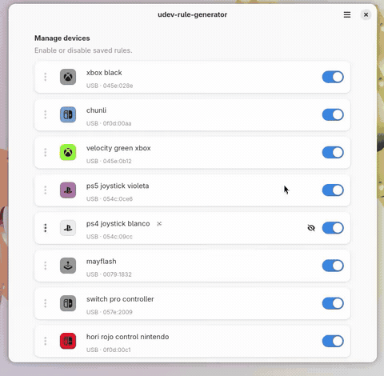

# udev-rule-generator

A Linux tool written in Python that detects joysticks and gamepads and creates
udev rules to **enable** them. Each saved device has exactly two states: its
rule is enabled or disabled. The GTK4/libadwaita desktop application is the
primary interface; the terminal interface exposes the same operations for
scripting and headless use.

The app **never installs rules automatically**. It only writes to
`/etc/udev/rules.d` after you choose a rule and authenticate through the GNOME
polkit dialog. No password is stored.

## Demo

[](docs/demo.webm)

**Demo recorded with udev-rule-generator v1.11.10.** It shows the GTK4
application detecting controllers, editing aliases, changing icons and colors,
and reordering device cards with drag and drop.

GitHub does not play repository `.webm` files inline, so the preview above is
an animated GIF. The full recording is available in
[`docs/demo.webm`](docs/demo.webm).

Three optional rule packages are bundled as reviewed snapshots:

- **[steam-devices](https://github.com/ValveSoftware/steam-devices/)** from
  Valve.
- **[game-devices-udev](https://codeberg.org/fabiscafe/game-devices-udev)**
  from Fabian Bornschein (fabiscafe).
- **[udev-joystick-blacklist](https://github.com/denilsonsa/udev-joystick-blacklist)**
  from Denilson Figueiredo de Sá (denilsonsa).

The optional **steam-devices** rules provide Valve's permissions for Steam
Input and SteamVR, including the `uinput` access that Steam needs to create
virtual controllers. They are useful when you use Steam's controller features
or SteamVR.

The optional **game-devices-udev** rules add Fabian Bornschein's community
rules for controllers that need a vendor-specific udev rule. They are useful
when the kernel or the generated per-device rule is not enough.

The optional **udev-joystick-blacklist** rules go in the opposite direction:
they block keyboards, mice, tablets, LED controllers, and other devices that
the kernel exposes as `/dev/input/js*` even though they are not joysticks.

All three rule packages are disabled by default and are never installed as
part of the application installation.

## What it solves

Controller support on Linux depends on udev rules that grant the active user
access to each device. Many distributions do not ship rules for every
controller, and some do not package rule sets such as
[`game-devices-udev`](https://codeberg.org/fabiscafe/game-devices-udev),
[`steam-devices`](https://github.com/ValveSoftware/steam-devices), or
[`udev-joystick-blacklist`](https://github.com/denilsonsa/udev-joystick-blacklist)
at all. This is especially common on immutable systems such as Fedora
Silverblue. The last one solves the opposite problem: it hides non-joystick
devices that the kernel exposes as controllers.

Copying rules from the internet is fragile: they are often tied to a specific
vendor, model, or old VID:PID, and they may grant permissions to devices you do
not own. udev-rule-generator avoids that by detecting the controller that is
actually connected, generating a narrow rule for it, and installing only that
rule after polkit authentication. The generated file is readable and can be
removed at any time.

The same interface works when a controller is not currently connected: saved
devices can be enabled or disabled later, and devices you no longer use can be
hidden from the main list.

## Features

- USB and Bluetooth controller detection with `udevadm`.
- Auxiliary input interfaces such as motion sensors, touchpads,
  accelerometers, gyroscopes, and magnetometers are filtered out.
- Device list with name, bus, VID:PID, serial, and `/dev/input/*` nodes.
- Permission rules with `MODE="0660"` and `TAG+="uaccess"`.
- Generated rule filenames use the `10-` prefix.
- Human-readable generated rules and `--dry-run`.
- Optional
  [steam-devices](https://github.com/ValveSoftware/steam-devices),
  [game-devices-udev](https://codeberg.org/fabiscafe/game-devices-udev), and
  [udev-joystick-blacklist](https://github.com/denilsonsa/udev-joystick-blacklist)
  packages.
- List and remove rules managed by the application.
- Saved devices registry with the latest rule for each controller, so the rule
  can be enabled or disabled without connecting the controller again.
- Per-device USB connect/disconnect button, shown on card hover to the left of
  the eye. It disconnects and reconnects the device through the kernel port
  interface when the hub supports per-port power switching, and through the
  device's `authorized` attribute otherwise, after one confirmation and one
  polkit authentication. It only appears while the USB device is present or
  its port is turned off.
- Hide saved devices with the eye button; restore them from the hidden-devices
  menu. Hiding also asks for confirmation.
- Only controllers with a complete VID and PID are listed under **Manage
  devices**.
- Inline **External rules** switches for
  [steam-devices](https://github.com/ValveSoftware/steam-devices),
  [game-devices-udev](https://codeberg.org/fabiscafe/game-devices-udev), and
  [udev-joystick-blacklist](https://github.com/denilsonsa/udev-joystick-blacklist)
  in the main window.
- GTK4/libadwaita GUI with automatic connection detection, Steam-aware GNOME
  notifications, and centered Pika Backup-style cards.
- Automatic language detection for English (US/UK) and Spanish.
- Flatpak manifest for GNOME 51 and a `build-flatpak.sh` toolbox wrapper.
- No external Python dependencies for the core.

## Requirements

### Native Fedora

```bash
sudo dnf install python3-gobject gtk4 libadwaita polkit
```

`udevadm` comes with systemd, which is already present on Fedora. The CLI does
not need GTK or libadwaita; the core uses only the Python standard library.

Debian/Ubuntu equivalents are `python3-gi`, `gir1.2-gtk-4.0`,
`gir1.2-adw-1`, and `polkitd`/`pkexec`. On Arch, install `python-gobject`,
`gtk4`, `libadwaita`, and `polkit`.

### Native install

```bash
# Installs the Python package with pip --user, plus the .desktop file and icon.
bash install-native.sh

udev-rule-generator --list
udev-rule-generator --gui
```

You can also run the GUI directly from the repository:

```bash
./udev-rule-generator-gui
```

If you run from the repository without installing the `.desktop` file, GNOME
notifications may appear without the application name or icon.

### Flatpak build requirements

- `flatpak`
- `flatpak-builder`
- `org.gnome.Platform//51` and `org.gnome.Sdk//51`
- Toolbx on Fedora Atomic (the build script handles it)

## Quick start (CLI)

From the repository:

```bash
./udev-rule-generator
```

Or, without the launcher:

```bash
python3 -m udev_rule_generator
```

The main menu lets you list controllers, install preset packages, and
view/remove installed rules. The non-interactive `--known`,
`--enable-known`, `--disable-known`, `--hide-known`, `--unhide-known`,
`--alias`, and `--unalias` options manage saved devices and aliases.

### Non-interactive commands

```bash
# List detected controllers
./udev-rule-generator --list

# Show the generated rule without installing it
./udev-rule-generator --device 1 --dry-run

# Install an enable rule for 045e:02fd (Xbox One)
./udev-rule-generator --device 045e:02fd --yes

# Install an external rule package (steam-devices, game-devices-udev,
# or udev-joystick-blacklist); use --presets all for the three
./udev-rule-generator --presets steam

# Show rules installed by this application
./udev-rule-generator --installed

# List saved devices and their last rule
./udev-rule-generator --known

# Enable or disable a saved rule without plugging in the controller
./udev-rule-generator --enable-known 045e:02fd --yes
./udev-rule-generator --disable-known 045e:02fd --yes

# Hide a saved device or show it again
./udev-rule-generator --hide-known 045e:02fd
./udev-rule-generator --unhide-known 045e:02fd

# Assign or remove a device alias
./udev-rule-generator --alias 045e:02fd "Xbox rojo"
./udev-rule-generator --unalias "Xbox rojo"

# Export or import a backup of saved devices and generated rules
./udev-rule-generator --export udev-rule-generator-backup.tar.gz
./udev-rule-generator --import udev-rule-generator-backup.tar.gz --yes

# Remove a managed rule
./udev-rule-generator --remove 10-udev-rule-generator-gamepad-045e-02fd-xbox-wireless-controller.rules
```

`--list` shows both connected controllers and saved controllers that are
currently disconnected, so you can enable a saved rule without plugging the
controller in. `--device` accepts a 1-based index from that list, a `VID:PID`
pair, or part of the device name. `--known` accepts a 1-based index from its
own list, a saved device ID, a rule filename, or part of the device name.
`--hide-known` removes the active rule when necessary and marks the device
hidden; `--unhide-known` only makes the saved device visible again.
`--alias` accepts a 1-based index from `--list`, a `VID:PID` pair, or part of
the device name; aliases also work for connected devices without a saved rule.
`--unalias` accepts the same selectors, including an existing alias.
`--export` writes a `.tar.gz` with saved devices, aliases, and generated rules;
`--import` merges devices and aliases without installing or activating rules.
Neither option includes steam-devices, game-devices-udev, or
udev-joystick-blacklist rules.
`--dry-run` never writes anything.
`--yes` skips the terminal confirmation; the polkit authentication dialog is
still shown.

## GUI

```bash
./udev-rule-generator --gui
```

Or:

```bash
./udev-rule-generator-gui
python3 -m gui
```

The main window is the device manager. It lists saved devices and any
connected controllers that do not have a saved rule yet.

- Saved devices have an enable/disable switch and their bus and VID:PID.
- Each device has a square button on the left. It opens a selector with
  monochrome symbolic icons (controller, joystick, input gaming, Nintendo
  Switch, PlayStation, Xbox, Steam, cool face, and D-pad) and ten light GNOME
  Terminal palette colors. The selected color fills the square and the icon
  appears inside it. Both choices are stored per device; the default color is
  white.
- A three-dot handle at the far left reorders devices with drag and drop. It
  has a wide invisible hit area without changing the row layout, is always
  visible, and the dragged preview is the full device card rather
  than just its text. The static card preview is locked to a vertical rail and
  the original row is hidden, so it looks like the original card is moving.
  Rows reorder live when crossing another card's midpoint and displaced cards
  animate into place. The custom order is stored in `devices.json` and included
  in backups.
- Each device has a pencil button to assign an alias. It opens an inline field
  with the original name as a light placeholder; the first typed character
  turns the pencil into a save tick. After saving, a grey X with the tooltip
  **Remove alias** asks for confirmation before restoring the original name.
  Escape cancels editing without saving.
- The pencil/X and hide buttons appear only while hovering a device card;
  the drag handle stays visible. They keep their space, so the title,
  connected badge, and switch do not move. USB device cards also show a
  connect/disconnect button to the left of the eye while hovering.
- The connect/disconnect button asks the USB hub to disable or enable the port
  through the standard `port/disable` interface available since Linux 6.0, but
  only when the hub reports per-port power switching. On hubs without that
  support it uses the device's `authorized` attribute instead, which is
  reversible. Both actions ask for confirmation first and use a single polkit
  authentication when the application is not running as root. If the device is
  physically disconnected, or is not a USB device, the button is not shown.
  This controls the USB connection only. A battery-powered Xbox controller
  whose firmware is already off may still need the physical Xbox button, a
  driver such as `xone`, or a real VBUS power cycle to turn on its LED.
- Aliases persist per device, including connected devices that do not have a
  saved rule yet.
- Clicking anywhere on a device card toggles its switch. The icon selector,
  alias button, hide button, and drag handle keep their own actions. The
  installed rule file is no longer opened from the row; open it with a text
  editor if you need to inspect it.
- A master switch in the **Gestionar dispositivos** header sets every visible
  switch, including the **Ignorados** rows, to the same position. It is ON only
  when all switches are ON. In the main list ON means enabled; in **Ignorados**
  ON means ignored/disabled. It stages the same changes as the row switches,
  and **Apply changes** sends them with one authentication.
- Controllers detected as joysticks have a green **Connected** tag that includes
  the active `js` node, for example `Connected · js0`. Saved USB devices that
  are physically connected but not detected show a gray **Disconnected** tag.
  Devices with no USB connection show no state tag at all.
- Devices that the kernel exposes with a `js` node but udev does not
  classify as joysticks appear under **Ignorados**. Each row's switch ignores
  the device when ON (HID driver unbound and `js` node released) and enables it
  when OFF (HID driver bound). The remaining USB controllers are rebound in
  order to compact to `js0`, `js1`, … While ignored, the device has no `hidraw`
  node, so LED control through OpenRGB is not available. The state is stored in
  `devices.json`; after a reboot udev binds the device again, so the switch
  starts off.
- A connected controller without a saved rule has a switch that stages its
  enable rule.
- Switch changes are applied together with **Apply changes**, so several
  devices can be enabled or disabled with one polkit authentication.
- The eye button hides a saved device. If its rule is active, hiding removes
  the rule first. A confirmation dialog avoids hiding a device by accident.
  Hidden devices live under the header menu **Hidden devices**, where they can
  be shown again.
- Controllers whose VID or PID is missing, malformed, or `0000` are not shown
  under **Manage devices**: without a reliable hardware identifier the
  generated rule would not be trustworthy.
- The header menu has **Export** and **Import** actions for `.tar.gz` backups.
  A backup contains `devices.json` with the saved devices, aliases, icons,
  colors, custom order, and hidden state, plus the udev rules generated by this
  application. Rules from steam-devices, game-devices-udev, and
  udev-joystick-blacklist are not included.
- **Import** merges the devices, aliases, icons, and colors from the archive.
  It does not install or activate any rule and does not request administrator
  authentication. Imported devices start disabled and can be enabled later
  from the normal switches.
- **Delete all data** removes saved devices, aliases, hidden-device state, and
  generated rules after a confirmation prompt. It rebinds ignored devices
  first, and it does not remove steam-devices, game-devices-udev, or
  udev-joystick-blacklist rule packages.

The main window also has **External rules** with independent switches for
[steam-devices](https://github.com/ValveSoftware/steam-devices),
[game-devices-udev](https://codeberg.org/fabiscafe/game-devices-udev), and
[udev-joystick-blacklist](https://github.com/denilsonsa/udev-joystick-blacklist).
Hovering over a switch shows how many of its rule files are installed.

The GUI monitors `udevadm monitor` while open and also polls every 5 seconds as
a fallback. When a controller connects or disconnects, the list updates
automatically. Connection notifications depend on Steam:

- If Steam is running, either natively or as a Flatpak, the application does
  not show its own connection toasts or GNOME notifications. Steam already
  reports controller connection changes.
- If Steam is not running, the application shows a single **GNOME
  notification** for the connection or disconnection. It does not show an
  in-app toast for these events.

Clicking a GNOME notification opens the window. The header menu contains
**Hidden devices**, **Rules test**, and About.

### Rules test

Open **Rules test** from the header menu to check the udev result for every
connected controller. The dialog shows:

- The device name, bus, VID:PID, and active input node.
- Whether udev reports `ID_INPUT_JOYSTICK`.
- Whether the node has the `uaccess` tag.
- Whether the saved rule is enabled, disabled, or not present.

A green check means udev sees the device as a joystick and grants the session
user access. This check uses `udevadm info --query=property`, so it does not
need root and reflects the current udev state.

Each connected device also has a **Test buttons** action. It opens the evdev
node (`/dev/input/eventN`) and shows button presses live. Noisy axis events are
shown in a separate compact line instead of filling the event log. This tests
the kernel input path after udev permissions are applied; it does not bypass
the kernel driver or use Steam/SDL.

### Saved devices

Saved devices are stored in:

```text
$XDG_CONFIG_HOME/udev-rule-generator/devices.json
```

Inside Flatpak it lives under
`~/.var/app/io.github.nicobm.UdevRuleGenerator/config/`.

`devices.json` keeps one entry per configured controller with its name,
VID:PID, bus, serial, input names, the latest rule, its filename and content,
a SHA-256 hash, whether the rule is active, and timestamps. It is a
small JSON registry, not a rule history database. Existing managed rules are
imported automatically the first time the app reads them, including rules
installed by older versions.

The main **Manage devices** list shows each saved device with a switch.
Changing switches marks pending changes; **Apply changes** sends all installs
and removals in one polkit prompt. This does not need the controller to be
connected.

The app reconciles the `active` flag with the files that actually exist in
`/etc/udev/rules.d`, so a rule deleted outside the app appears as disabled.
Activating a saved device regenerates the rule with the current app version
and the current filename convention.

Only the latest enable rule for a device is stored. If you manually install a
rule for the same controller outside the app, remove the stale file so
disabling the saved device leaves no rule behind.

### Language

The application detects the locale at startup:

- `en_US` or `en_GB` → English.
- Any Spanish variant (`es_ES`, `es_AR`, `es_MX`, etc.) → Spanish.
- Other locales → English as the fallback.

The detection applies to the GUI, CLI, dialogs, notifications, error messages,
and generated rule headers. Restart the app after changing the locale.

`LC_ALL` takes precedence over `LC_MESSAGES`, `LANG`, and `LANGUAGE`. To force a
language for a single run:

```bash
LC_ALL=en_US.UTF-8 LANG=en_US.UTF-8 ./udev-rule-generator --list
LC_ALL=es_ES.UTF-8 LANG=es_ES.UTF-8 ./udev-rule-generator --list
```

## Flatpak

The manifest is at the repository root:

```text
io.github.nicobm.UdevRuleGenerator.json
```

Build and install:

```bash
bash build-flatpak.sh
```

The script:

1. On Fedora Atomic, creates/enters the `udev-rule-generator` toolbox if
   `flatpak-builder` is missing.
2. Installs `flatpak` and `flatpak-builder` inside the toolbox when needed.
3. Installs `org.gnome.Platform//51` and `org.gnome.Sdk//51`.
4. Builds with `flatpak-builder` and exports to `repo/`.
5. Installs from the local `udev-rule-generator-local` remote and leaves that
   remote disabled.

Run:

```bash
flatpak run io.github.nicobm.UdevRuleGenerator
flatpak run --command=udev-rule-generator io.github.nicobm.UdevRuleGenerator
flatpak run --command=udev-rule-generator io.github.nicobm.UdevRuleGenerator --list
```

The manifest is intentionally minimal:

```json
"finish-args": [
    "--socket=wayland",
    "--device=input",
    "--device=dri",
    "--talk-name=org.freedesktop.Flatpak",
    "--unshare=network"
]
```

- Wayland only; there is no X11 fallback.
- Input and GPU access; no sound or extra devices.
- `--device=dri` enables GPU acceleration. Without it, Mesa/Zink may print
  EGL warnings and GTK falls back to software rendering.
- No network access.
- No `/etc`, home, or host filesystem mounts.
- `org.freedesktop.Flatpak` is required to run `udevadm` and `pkexec` on the
  host through `flatpak-spawn --host`. Without it, the UI could open but the app
  could not detect devices or install rules. It is a broad host-integration
  permission, as with any utility of this kind.

If your system does not have the GNOME 51 runtime yet, change
`runtime-version` in the manifest and `RUNTIME_VERSION` in `build-flatpak.sh`
to the GNOME version you have installed.

## Generated rules

### Enable

For a USB controller, the file is named for example
`10-udev-rule-generator-gamepad-045e-02fd-xbox-wireless-controller.rules` and contains:

```udev
# Generated by udev-rule-generator 1.13.10

# Device: Xbox Wireless Controller
ACTION!="remove", SUBSYSTEM=="usb", ATTRS{idVendor}=="045e", ATTRS{idProduct}=="02fd", MODE="0660", TAG+="uaccess"
ACTION!="remove", SUBSYSTEMS=="input", ATTRS{name}=="Xbox Wireless Controller", ENV{ID_INPUT_JOYSTICK}="1", MODE="0660", TAG+="uaccess"
ACTION!="remove", SUBSYSTEM=="hidraw", ATTRS{idVendor}=="045e", ATTRS{idProduct}=="02fd", MODE="0660", TAG+="uaccess"
```

The header is intentionally minimal: the app version, a blank line, and the
device name. Each controller gets its own file, so there is one `# Device:`
block per file. Installing rules for several controllers creates several
files; it does not merge them into one.

Existing rules keep their previous filenames until they are disabled and
enabled again or reinstalled. New rules use the
`10-udev-rule-generator-gamepad-…` naming. Disabling a saved device removes
its rule file; the rule is simply removed.

Because of that, `cat /etc/udev/rules.d/*` concatenates several files and the
header appears once per file. That is expected. To inspect a single device,
open its specific `.rules` file. The app always reads the marker from the
first line of each file.

`TAG+="uaccess"` lets systemd-logind grant access to the active session user,
which is what SDL, Steam, and similar tools use. `ID_INPUT_JOYSTICK=1` helps
udev mark the device as a joystick.

## External rule packages

The application can install three optional external packages. None is
installed automatically: each one has its own switch under **External rules**
and can also be installed from the CLI with `--presets`.

| Package | Installed files | What it does | License |
| --- | --- | --- | --- |
| steam-devices | `71-steam-input.rules`, `71-steam-vr.rules` | Valve's uinput, Steam Input, and SteamVR permissions. Requires the kernel `uinput` module. | MIT |
| game-devices-udev | `71-*-gdu.rules` | Fabian Bornschein's community rules for controllers that are not covered by the kernel or by the generated per-device rule. | MIT |
| udev-joystick-blacklist | `65-these-are-not-joysticks.rules` | Blocks keyboards, mice, tablets, LED controllers, and other non-joysticks that the kernel exposes as `/dev/input/js*`. It is a blocklist: it does not grant permissions or free the `js` index. Use **Ignorados** when you also want to release the node and renumber the remaining controllers. | Public domain |

## Steam devices

The optional
**[steam-devices](https://github.com/ValveSoftware/steam-devices)** package
from Valve installs:

- `71-steam-input.rules`
- `71-steam-vr.rules`

It is copied only when you enable the
**[steam-devices](https://github.com/ValveSoftware/steam-devices)** switch in
the main window, or when you run:

```bash
./udev-rule-generator --presets steam
```

To remove it from the CLI:

```bash
./udev-rule-generator --remove 71-steam-input.rules 71-steam-vr.rules --yes
```

The package provides the uinput/Steam Input permissions used by Steam and
SteamVR. It is not installed automatically.

Steam Input requires the kernel `uinput` module. If the application does not
detect it, the **steam-devices** switch is disabled, cannot be toggled, and its
description is replaced by a red warning explaining that `uinput` must be
enabled. For GUI testing without unloading the real module:

```bash
TEST_UINPUT_OFF=1 ./udev-rule-generator-gui
flatpak run --env=TEST_UINPUT_OFF=1 io.github.nicobm.UdevRuleGenerator
```

## game-devices-udev

The optional
**[game-devices-udev](https://codeberg.org/fabiscafe/game-devices-udev)**
package from Fabian Bornschein (fabiscafe) installs its reviewed rule
snapshot, installed as `71-*-gdu.rules`. It covers many controllers that are not
handled by the kernel or by the generated per-device rule.

Enable **game-devices-udev** in **External rules**, or install it from the CLI:

```bash
./udev-rule-generator --presets game-devices-udev
```

The package is not installed automatically.

## udev-joystick-blacklist

The optional
**[udev-joystick-blacklist](https://github.com/denilsonsa/udev-joystick-blacklist)**
package by Denilson Figueiredo de Sá installs
`65-these-are-not-joysticks.rules`. It prevents keyboards, mice, tablets, LED
controllers, and other non-joystick devices from being exposed as
`/dev/input/js*`.

The rules are public domain. The app ships the `0000` variant from the
`after_kernel_4_9` directory, which is the recommended one for kernels 4.9 and
newer, as a single installed file (`65-these-are-not-joysticks.rules`). The
upstream repository also contains the pre-4.9 `0000` file and two `-rm`
variants; the `-rm` variants delete the device node with a `RUN` directive,
which the app rejects, and the pre-4.9 file is not needed on current kernels.

Enable **udev-joystick-blacklist** in
**External rules**, or install it from the CLI:

```bash
./udev-rule-generator --presets udev-joystick-blacklist
```

This package is a blocklist, not a permission package. For every listed
device it sets `MODE="0000"` on the `js` node and clears
`ID_INPUT_JOYSTICK`. It does not unregister the kernel input device, so it
does not free the `jsN` index; if you also want to release the node and
renumber the remaining controllers, use the **Ignorados** switch. Both
features are independent.

It is not installed automatically.

Install all external packages at once:

```bash
./udev-rule-generator --presets all
```

### How the external files are sourced

The application **does not download rules at runtime**. It ships reviewed
copies in `udev_rule_generator/data/presets/`, so Flatpak builds stay offline
and the installed files are reproducible.

To refresh the snapshots during development:

```bash
python3 tools/update_presets.py --check
python3 tools/update_presets.py
git diff udev_rule_generator/data/presets
```

The updater downloads only allowlisted files from
[GitHub](https://github.com/ValveSoftware/steam-devices/),
[Codeberg](https://codeberg.org/fabiscafe/game-devices-udev), and
[GitHub](https://github.com/denilsonsa/udev-joystick-blacklist) over HTTPS. It
rejects unexpected filenames, oversized or binary content, and any `RUN`,
`PROGRAM`, or `IMPORT` directive except the reviewed Valve/fabiscafe `udevadm`
command. The bundled snapshots are validated again when the app builds the
install payload, so a compromised upstream file cannot add arbitrary command
execution without changing the reviewed allowlist. The updater never executes
downloaded content; it only validates and writes text.

Review and test the diff before committing it. Valve's
[steam-devices](https://github.com/ValveSoftware/steam-devices/) and Fabian
Bornschein's
[game-devices-udev](https://codeberg.org/fabiscafe/game-devices-udev) are MIT;
Denilson Figueiredo de Sá's
[udev-joystick-blacklist](https://github.com/denilsonsa/udev-joystick-blacklist)
is public domain. The full license texts and notices are in
[`THIRD_PARTY_NOTICES.md`](THIRD_PARTY_NOTICES.md).

## Authentication

The app never asks for a password directly. When it needs to write to
`/etc/udev/rules.d`, it runs:

```bash
pkexec sh -c 'install -m 0644 ... /etc/udev/rules.d/ && udevadm control --reload-rules && udevadm trigger ...'
```

`pkexec` asks polkit, and GNOME shows its administrator authentication dialog.
The app does not run `sudo`, never receives the password, and does not store it
in a file. Depending on the polkit agent and policy, the authorization may stay
cached for a few minutes; the app does not control that cache. To avoid
repeated prompts, switch changes are batched and applied with one pkexec call.
If you cancel, nothing is written. After installation, udev reloads the rules
and the app triggers `change` for permissions or `add` for USB
deauthorization.

Inside Flatpak, the command runs on the host through
`flatpak-spawn --host pkexec ...`, so the dialog is still the host GNOME
dialog.

## Files created

Rules go to `/etc/udev/rules.d`:

- `10-udev-rule-generator-gamepad-<vid>-<pid>-<name>.rules`
- `71-steam-input.rules` and `71-steam-vr.rules` (steam-devices package)
- `71-*-gdu.rules` and `71-uinput-dev-early-creation.rules`
  (game-devices-udev package)
- `65-these-are-not-joysticks.rules` (udev-joystick-blacklist package)

User configuration goes to `$XDG_CONFIG_HOME/udev-rule-generator/`:

- `devices.json`: saved devices and their latest generated rule.

Generated rules have a `# Generated by udev-rule-generator` header; presets
have `# Installed by udev-rule-generator`. The app uses that marker to list and
remove its own rules without touching unrelated ones.

## Troubleshooting

### No joystick appears

```bash
udevadm info --export-db | grep -i -B5 -A20 joystick
ls -l /dev/input/js* /dev/input/event*
```

If the controller is connected but not listed, disconnect and reconnect it. In
Flatpak, make sure the app has the `org.freedesktop.Flatpak` permission from
the manifest.

### The password dialog does not appear

Check that the GNOME polkit agent is running:

```bash
pkexec true
```

If `pkexec` is missing, install polkit. In Flatpak, the dialog opens on the
host, not inside the sandbox.

### The rule does not apply

```bash
sudo udevadm control --reload-rules
sudo udevadm trigger
```

Then disconnect and reconnect the controller. To inspect what udev is doing:

```bash
udevadm test /sys/class/input/js0
```

### Undo a rule

From the app:

```bash
./udev-rule-generator --installed
./udev-rule-generator --remove RULE_NAME.rules
```

Or manually:

```bash
sudo rm /etc/udev/rules.d/RULE_NAME.rules
sudo udevadm control --reload-rules
sudo udevadm trigger
```

## Website (GitHub Pages)

The repository root includes a static `index.html` landing page. To publish it
with GitHub Pages:

1. Open the repository on GitHub and go to **Settings → Pages**.
2. Under **Build and deployment**, choose **Deploy from a branch**.
3. Select the `main` branch and the `/ (root)` folder.
4. Save. GitHub will serve `index.html` at the Pages URL.

The page is plain HTML/CSS/JavaScript and does not need a build step. It uses
the application icon from `gui/data/icons/`.

## Development

```bash
python3 -m unittest discover -s tests -v
python3 -m compileall -q udev_rule_generator gui
```

Development-only icon catalog:

```bash
TEST=1 ./udev-rule-generator --gui
# Flatpak:
flatpak run --env=TEST=1 io.github.nicobm.UdevRuleGenerator
```

With `TEST=1`, the header menu shows **View emoji**, which lists the Adwaita
symbolic icons plus additional Bootstrap Icons gaming and device candidates
available for future device icon choices.

Project layout:

```text
udev_rule_generator/
  cli.py          # terminal UI and arguments
  devices.py      # detection and grouping via udevadm/procfs
  rules.py        # rule generation and validation
  presets.py      # bundled steam-devices, game-devices-udev, and blacklist
  privileged.py   # pkexec, installation, and udev reload
  installed.py    # reading managed rules
  known.py        # saved devices and their latest rule
  backup.py       # .tar.gz export/import of devices and generated rules
  userconfig.py   # config paths and stable device identity
  host.py         # native commands or flatpak-spawn --host
  monitor.py      # udevadm monitor for GUI auto-detection
  i18n.py         # Spanish/English detection and translations
gui/
  application.py
  window.py
  device_manager.py  # main saved-device list and switches
  hidden_dialog.py   # restore hidden saved devices
  installed_dialog.py
  data/           # .desktop, metainfo, and icon
tools/
  update_presets.py  # refresh the bundled external rule snapshots
tests/
```

The core tests use `udevadm` and `/proc` fixtures and do not require hardware
or root permissions.

## License

The project code is MIT. The
[steam-devices](https://github.com/ValveSoftware/steam-devices/) and
[game-devices-udev](https://codeberg.org/fabiscafe/game-devices-udev) rules
are MIT; the
[udev-joystick-blacklist](https://github.com/denilsonsa/udev-joystick-blacklist)
rules are public domain. See
[`THIRD_PARTY_NOTICES.md`](THIRD_PARTY_NOTICES.md).

## Built with

This project was developed with AI assistance from **DeepSeek V4.1 Flash
1017** using **OpenCode**.
